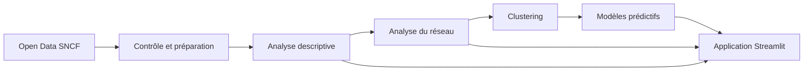

<div align="center">

# Analyse de la régularité du réseau TGV

### Exploration des données SNCF et étude de la structure du réseau

**Explorer la ponctualité des TGV, comprendre les facteurs associés aux retards et évaluer l'apport de la structure du réseau à leur prédiction.**

[](https://www.python.org/)
[](https://streamlit.io/)
[](https://docs.astral.sh/uv/)
[](https://pytest.org/)
[](https://www.sphinx-doc.org/)

**[Accéder à l'application](https://iadata701-projet.streamlit.app/)** | **[Code source](https://github.com/husseindakroube/IADATA701-PROJET)** | **[Intégration continue](https://github.com/husseindakroube/IADATA701-PROJET/actions)**

*Projet académique IADATA701 : Analyse de données et développement Python pour la production*

</div>

---

## Présentation du projet

Un retard ferroviaire se résume rarement à un chiffre. Le projet transforme les données ouvertes de régularité mensuelle des TGV en une exploration interactive du réseau français : quelles liaisons sont les moins régulières ? Quels types de retards observe-t-on ? Les caractéristiques du réseau sont-elles associées à la ponctualité ? Et permettent-elles de mieux prédire les retards ?

> **Notre question de recherche**
>
> Dans quelle mesure la structure du réseau TGV est-elle associée à la régularité des liaisons, et peut-on exploiter cette structure pour améliorer la prédiction des retards ?

L'application associe **exploration des données**, **analyse de graphes**, **clustering** et **comparaison de modèles prédictifs**, tout en exposant les limites de l'interprétation statistique.

## Fonctionnalités de l'application

| Page | Ce que vous pouvez découvrir |
| :--- | :--- |
| **Accueil** | La démarche, la problématique et les chiffres clés de l'étude. |
| **Qualité des données** | Les contrôles de cohérence, les valeurs manquantes, les anomalies et les choix de préparation des données. |
| **Liaisons et réseau** | Une carte interactive, le détail des liaisons, des comparaisons de trajets, des séries temporelles et des métriques de centralité. |
| **Structure et régularité** | Les associations entre caractéristiques du réseau et indicateurs de régularité, avec leurs précautions d'interprétation. |
| **Profils et clusters** | Quatre profils de liaisons, leurs caractéristiques, les causes de retard et une projection par analyse en composantes principales (ACP/PCA). |
| **Prédictions** | Une comparaison des modèles selon leurs erreurs et leurs performances, avec exploration des résultats par liaison. |
| **Conclusions** | La synthèse des résultats, la réponse à la problématique et les limites de l'étude. |

**Application en ligne :** https://iadata701-projet.streamlit.app/

## Données et périmètre

**Source :** [SNCF Open Data : Régularité mensuelle TGV (AQST)](https://ressources.data.sncf.com/explore/dataset/regularite-mensuelle-tgv-aqst/information/).

Le jeu de données comporte des observations mensuelles par service et par liaison (gare de départ vers gare d'arrivée), notamment sur les circulations, annulations, retards et causes de retard.

Les jeux de données et exports intégrés au dépôt ne représentent **pas tous le même périmètre** :

| Jeu utilisé | Périmètre des données livrées |
| :--- | :--- |
| Observations préparées (`sncf.parquet`) | **12 907 observations**, de janvier 2018 à septembre 2026 ; **59 gares** et **146 combinaisons** service / départ / arrivée. |
| Données de la carte (`liaisons_detail.csv`) | **130 liaisons orientées** enrichies de statistiques et de coordonnées. |
| Profils de liaisons (`clusters_liaisons.csv`) | **65 paires de gares non orientées**, réparties en **4 groupes**. |
| Comparaison prédictive | **1 857 observations communes** dans l'échantillon de test, de juillet 2025 à septembre 2026. |

> **Important :** les indicateurs de la carte, les résultats de clustering et les performances prédictives sont calculés sur des unités et des périmètres distincts. Leurs effectifs ne doivent pas être comparés directement.

## Méthodologie



**1. Qualité et préparation.** Vérification du schéma, des clés, des valeurs manquantes et de la cohérence des comptages. Les anomalies sont signalées à l'aide d'indicateurs explicites plutôt que corrigées silencieusement.

**2. Analyse de réseau.** Construction de graphes ferroviaires et calcul d'indicateurs tels que les degrés, l'intermédiarité, la proximité et le PageRank ; étude des associations entre ces caractéristiques et la régularité.

**3. Clustering.** Standardisation des caractéristiques de liaison et application de K-Means pour identifier quatre profils, avec visualisation par ACP/PCA.

**4. Prédiction.** Évaluation d'une référence naïve historique et de quatre variantes : **A** (baseline), **B** (+ variables de graphe), **C** (+ cluster) et **D** (+ graphe et cluster). Comparaison notamment par **MAE**, **RMSE** et **R²**.

### Principaux résultats

Les associations observées entre les propriétés du réseau et la régularité restent **modestes** ; elles ne permettent pas de conclure que la position d'une gare ou d'une liaison *cause* ses retards. De même, l'ajout de variables de graphe ou de cluster n'entraîne pas une amélioration systématique des prédictions.

Le modèle **A** est présenté comme une solution simple dans l'application, **pas comme le meilleur modèle sur toutes les métriques** : la référence naïve historique obtient notamment un meilleur R² sur l'échantillon évalué. Ces nuances font partie des conclusions de l'étude.

## Installation et exécution

### Prérequis

- **Python 3.12**, **Git** et [**uv**](https://docs.astral.sh/uv/getting-started/installation/).
- Un terminal, depuis la racine du dépôt.

```bash
# 1. Récupérer le projet
git clone https://github.com/husseindakroube/IADATA701-PROJET.git
cd IADATA701-PROJET

# 2. Installer l'environnement et les dépendances verrouillées
uv sync --locked --dev

# 3. Lancer l'application
uv run --locked streamlit run app/app.py
```

Ouvrir ensuite l'adresse affichée dans le terminal, généralement **http://localhost:8501**.


## Organisation du dépôt

```text
IADATA701-PROJET/
├── app/                         # Application Streamlit, 7 pages, styles et utilitaires
│   ├── app.py                   # Point d'entrée
│   ├── pages/                   # Pages thématiques
│   └── utils/                   # Chargement, carte, journalisation de l'activité...
├── src/projet_kit_data/        # Modules métier : ETL, EDA, graphes, ML, logs
├── data/
│   ├── raw/                     # Données sources
│   ├── processed/               # Exports préparés, graphes, clusters, prédictions
│   └── reports/                 # Rapports et figures d'analyse
├── notebooks/                   # 5 notebooks d'exploration et de modélisation
├── scripts/                     # Analyses, expériences et utilitaires de déploiement
├── tests/                       # Tests unitaires et d'intégration
├── docs/                        # Documentation Sphinx et notes méthodologiques
├── logs/examples/               # Journaux de démonstration simulés
├── models/                      # Modèles enregistrés
├── images/                      # Ressources graphiques
├── .github/workflows/ci.yml     # Pipeline GitHub Actions
├── .streamlit/config.toml       # Configuration Streamlit
├── pyproject.toml               # Projet Python et outils de qualité
├── uv.lock                      # Dépendances verrouillées
└── README.md
```

### Technologies principales

| Domaine | Outils |
| :--- | :--- |
| Application web et visualisations | Streamlit, Plotly, Folium, streamlit-folium, Matplotlib |
| Manipulation et analyse | Pandas, Polars, NumPy, SciPy, statsmodels |
| Réseaux et machine learning | NetworkX, scikit-learn |
| Environnement Python | uv, `pyproject.toml`, `uv.lock` |
| Qualité et tests | Ruff, pytest, pytest-cov |
| Documentation | Sphinx |
| Intégration continue | GitHub Actions |

## Qualité du code, tests et intégration continue

La qualité logicielle fait partie intégrante du projet : code organisé en modules, annotations de type, docstrings, gestion des erreurs et journalisation.

Pour reproduire localement les contrôles principaux :

```bash
# Analyse statique et docstrings
uv run --locked ruff check app src scripts tests docs/conf.py

# Formatage
uv run --locked ruff format --check app src scripts tests docs/conf.py

# Vérification syntaxique
uv run --locked python -m compileall -q app src scripts

# Tests et couverture
uv run --locked pytest -q \
  --cov=src/projet_kit_data --cov=app \
  --cov-fail-under=90.1 \
  --cov-report=term-missing \
  --cov-report=html:reports/coverage
```

**Dernière validation locale documentée dans le dépôt (18 novembre 2026) :** 172 tests réussis et **91,95 % de couverture** sur le périmètre `app/` et `src/projet_kit_data/`.

Le workflow [`.github/workflows/ci.yml`](.github/workflows/ci.yml) s'exécute lors des **pushs**, des **Pull Requests vers `main`** et des lancements manuels. Il vérifie :

- le style et le formatage avec Ruff ;
- la présence des docstrings publiques et la compilation Python ;
- la génération de la documentation Sphinx sans avertissement ;
- les tests pytest et une **couverture minimale de 90,1 %** ;
- la création d'exemples de logs simulés.

Les rapports de tests et la documentation HTML sont conservés sous forme d'**artefacts GitHub Actions pendant 14 jours**.

## Documentation technique

Les sources de la documentation se trouvent dans [`docs/`](docs/). Pour générer la version HTML :

```bash
uv run --locked sphinx-build -W --keep-going -b html docs docs/_build/html
```

Ouvrir ensuite `docs/_build/html/index.html`. La documentation décrit notamment la prise en main, l'architecture, les modules Python et la journalisation.

Pour plus de détails sur la livraison et la CI : [`docs/CI_CD.md`](docs/CI_CD.md).

## Journalisation

L'application utilise le module standard `logging` avec rotation des fichiers :

| Fichier | Usage |
| :--- | :--- |
| `logs/debug.log` | Événements applicatifs, interactions et informations de diagnostic. |
| `logs/error.log` | Erreurs et incidents de niveaux `ERROR` et `CRITICAL`. |

Les fichiers sont configurés avec une limite de **5 Mio** et **trois sauvegardes**. Les journaux opérationnels ne sont pas destinés à être versionnés ; les exemples présents dans [`logs/examples/`](logs/examples/) ont été produits à partir d'événements **simulés**. Sur un hébergement cloud, les fichiers locaux ne garantissent pas une conservation durable.

## Déploiement

**Lien de l'application : [iadata701-projet.streamlit.app](https://iadata701-projet.streamlit.app/)**

Le déploiement est configuré à partir du dépôt GitHub avec les paramètres suivants :

| Paramètre | Valeur |
| :--- | :--- |
| Dépôt | `husseindakroube/IADATA701-PROJET` |
| Branche de référence | `main` |
| Point d'entrée | `app/app.py` |
| Version Python | `3.12` |
| Plateforme | Streamlit Community Cloud |

**Workflow de contribution :** branche de travail, commit, push, Pull Request, vérification de la CI, puis fusion dans `main`.

> **Note :** Streamlit Community Cloud et GitHub Actions sont deux services distincts. La réussite de la CI ne suffit pas, à elle seule, à garantir le bon fonctionnement du site en production. Après chaque livraison importante, vérifier l'accès public et les pages de l'application.


## Projet et crédits

Projet réalisé en équipe dans le cadre du cours **IADATA701**, autour de l'analyse des données SNCF et des pratiques de développement Python pour la production.

**Source des données :** [SNCF Open Data : Régularité mensuelle TGV AQST](https://ressources.data.sncf.com/explore/dataset/regularite-mensuelle-tgv-aqst/information/).

Les références et ressources graphiques sont précisées dans [`images/SOURCES.md`](images/SOURCES.md).

---

**Application :** [Consulter l'analyse interactive](https://iadata701-projet.streamlit.app/)  
**Dépôt :** [IADATA701-PROJET](https://github.com/husseindakroube/IADATA701-PROJET)
