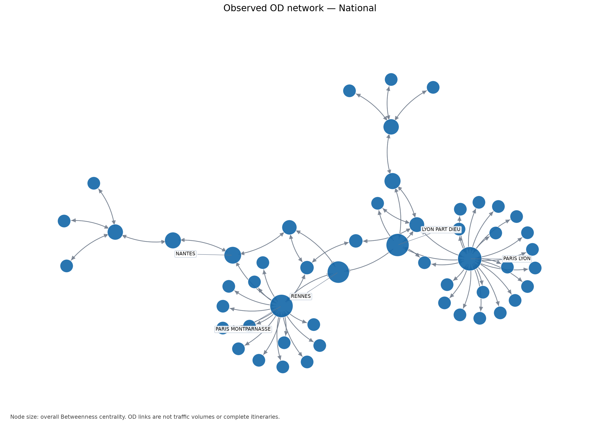
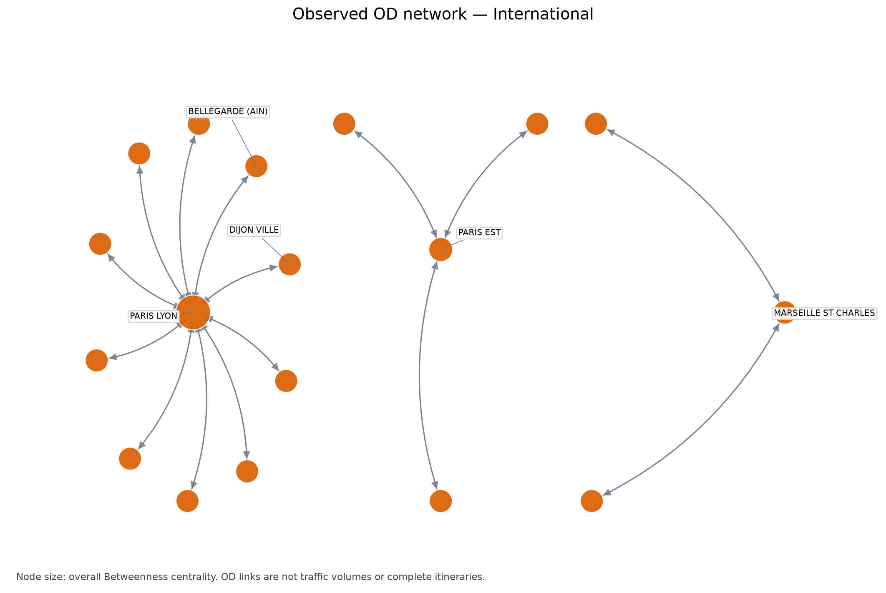
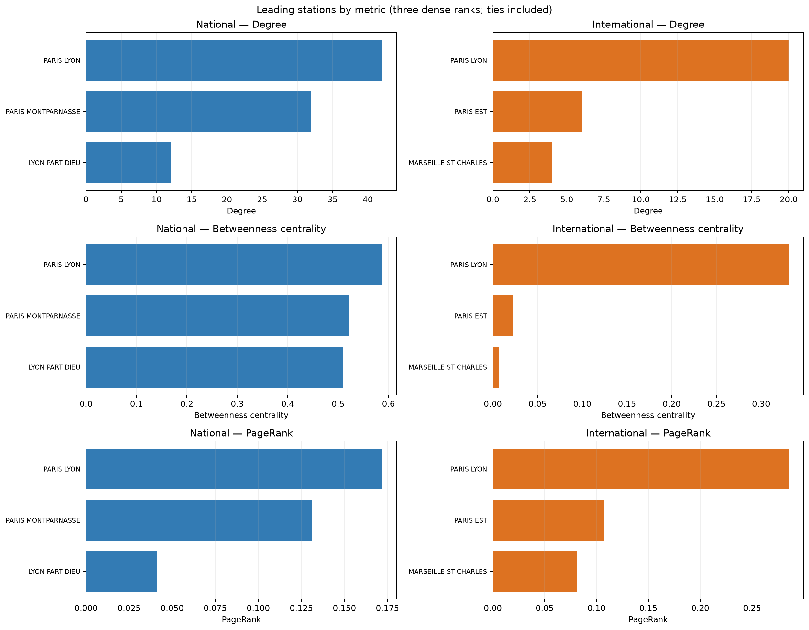
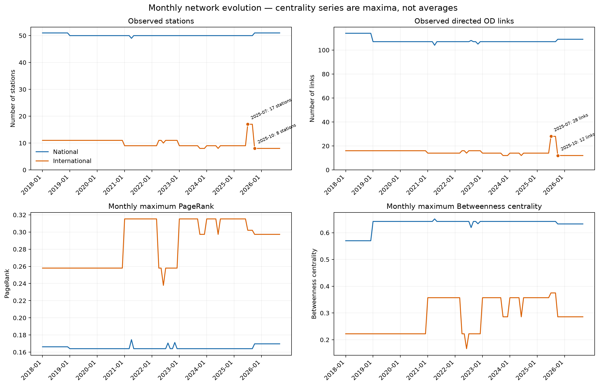
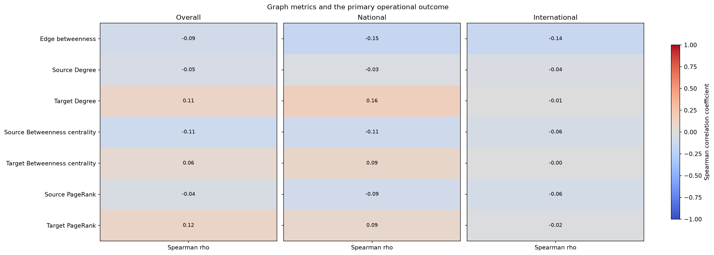
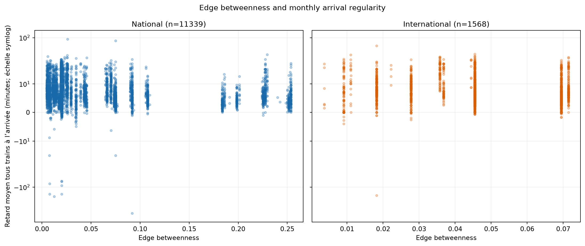
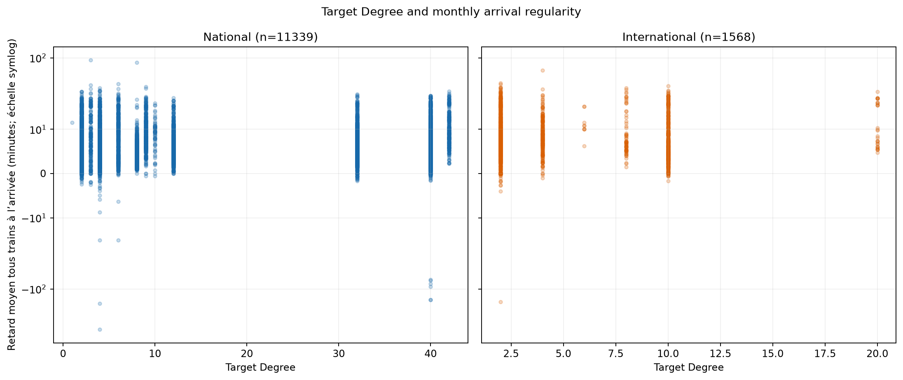
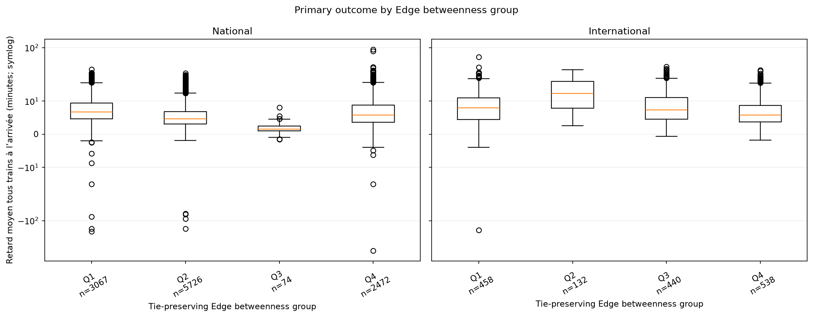

# Réseau TGV et régularité des liaisons

## 1. Introduction et question de recherche

Dans ce projet, nous étudions les relations entre la structure des liaisons origine-destination observées et la régularité des services TGV. La question qui guide l’analyse est : **« Dans quelle mesure la structure du réseau TGV est-elle associée à la régularité des liaisons ? »**

Le jeu de recherche rassemble 12 907 observations mensuelles, de janvier 2018 à septembre 2026, pour les services National et International. Nous décrivons d’abord les graphes et les indicateurs opérationnels, puis nous examinons les corrélations et les résultats par groupes de centralité. Ces analyses sont exploratoires : une liaison OD n’est pas nécessairement un segment physique ou un itinéraire confirmé, et les métriques de graphe ne mesurent ni le trafic voyageurs ni la propagation des retards.

<!-- BEGIN GENERATED DESCRIPTIVE CONTENT -->
## 2. Structure du réseau

### Couverture et connexité

Nous commençons par comparer les graphes de liaisons origine-destination observées pour les deux services. Le réseau National couvre davantage de gares et de liaisons; le tableau précise aussi comment chaque graphe se répartit en composantes faiblement et fortement connexes.

| Service | Gares | Liaisons dirigées | Composantes faiblement connexes | Composantes fortement connexes | Nœuds dans la plus grande composante faible |
| --- | --- | --- | --- | --- | --- |
| International | 18 | 30 | 3 | 3 | 11 |
| National | 52 | 116 | 1 | 1 | 52 |

Le graphe International comprend 3 composantes faiblement connexes et 3 composantes fortement connexes; le graphe National comprend une composante faiblement connexe et une composante fortement connexe.

Dans un graphe orienté, une composante faiblement connexe relie les nœuds si l’on ignore le sens des arcs; une composante fortement connexe exige des chemins orientés dans les deux sens entre ses nœuds. Le réseau National forme une seule composante faible et une seule composante forte. Le réseau International compte trois composantes faibles, dont la plus grande réunit 11 gares, et trois composantes fortes. Ces chiffres décrivent les OD présentes dans les données, pas l’ensemble de l’infrastructure ferroviaire.

### Importance des gares

Le degré compte les relations entrantes et sortantes ; la betweenness centrality et PageRank décrivent d’autres positions dans le graphe orienté. Ces mesures aident à repérer les gares centrales dans les OD observées, mais ne mesurent ni le nombre de voyageurs ni la fréquence des trains.

| Service | Mesure | Gare | Valeur |
| --- | --- | --- | --- |
| International | Centralité d’intermédiarité | PARIS LYON | 0.3309 |
| International | Degré | PARIS LYON | 20 |
| International | PageRank | PARIS LYON | 0.2853 |
| National | Centralité d’intermédiarité | PARIS LYON | 0.5869 |
| National | Degré | PARIS LYON | 42 |
| National | PageRank | PARIS LYON | 0.1717 |

Dans les deux services, Paris Lyon est en tête des trois mesures présentées. La distribution de Betweenness centrality comprend toutefois une forte part de zéros : International, Centralité d’intermédiarité : 83.3% de valeurs égales à zéro; National, Centralité d’intermédiarité : 75.0% de valeurs égales à zéro. La position dominante de quelques gares ne signifie pas que toutes les gares jouent le même rôle topologique; elle ne permet pas non plus de conclure à un rôle opérationnel causal.

### Importance des liaisons OD

L’intermédiarité des arêtes (edge betweenness) indique la fréquence avec laquelle une arête intervient dans les plus courts chemins du graphe orienté. La distribution montre des valeurs concentrées près du bas de l’échelle et quelques valeurs plus élevées.

**Valeurs observées.** National : 2 liaison(s) partagent le maximum (0.2289); exemples : LYON PART DIEU → RENNES; RENNES → LYON PART DIEU. International : 20 liaison(s) partagent le maximum (0.0327); exemples : BARCELONA → PARIS LYON; BELLEGARDE (AIN) → PARIS LYON.

Plusieurs liaisons partagent les valeurs maximales, notamment 20 liaisons International. Cette mesure d’intermédiarité des arêtes décrit une position dans le graphe ; elle ne représente ni le trafic ni un volume de passagers. Les ex æquo sont conservés dans le tableau de classement.

## 3. Évolution temporelle

La série mensuelle permet de voir si la couverture observée reste stable. Les panneaux de centralité représentent les maxima mensuels, et non des moyennes du réseau.

International : en juillet 2025, le graphe passe à 17 gares et 28 liaisons dirigées jusqu’en septembre. En octobre 2025, il passe à 8 gares et 12 liaisons dirigées; cette configuration persiste jusqu’à 2026-09. Les changements sont nets dans le graphe International : ils décrivent le contenu des observations à ces dates, mais les données disponibles n’en établissent pas la cause.

## 4. Régularité opérationnelle

Après la topologie, nous regardons les retards et les annulations rapportés pour les mêmes liaisons mensuelles. Cette étape décrit les résultats opérationnels avant de les mettre en relation avec les métriques de graphe.

Pour rendre les distributions lisibles, le panneau principal sépare les observations sous −15 minutes du retard moyen tous trains; les 16 valeurs de retard moyen des trains retardés supérieures à 120 minutes sont présentées dans un panneau distinct. Ces valeurs restent dans le jeu de recherche et dans les statistiques complètes. Le zoom des taux d’annulation ne remplace pas les valeurs manquantes par zéro.
Le graphique signale 11 retards moyens tous trains sous −15 minutes (National 10, International 1), 16 observations au-dessus de 120 minutes, 1235 taux d’annulation au-dessus de 0,10 et 73 taux manquants.

Les médianes sont de 5,35 contre 7,15 min pour le retard moyen tous trains, et de 33,20 contre 37,71 min parmi les trains retardés (National puis International). Les moyennes complètes dépassent les médianes pour ces indicateurs, ce qui montre que les valeurs hautes influencent les moyennes. Pour les annulations, la médiane est proche de 1 % tandis que la moyenne est proche de 4 % dans les deux services. Les 73 taux manquants sont signalés comme invalides lorsque le nombre de trains planifiés ne permet pas de calculer le ratio; ils ne signifient pas zéro annulation.

| Service | Indicateur | N valide / manquant | Médiane | Moyenne complète |
| --- | --- | --- | --- | --- |
| International | Retard moyen tous trains à l’arrivée (min) | 1568 / 0 | 7.15 | 8.13 |
| International | Retard moyen des trains retardés (min) | 1568 / 0 | 37.71 | 38.83 |
| International | Taux d’annulation (part) | 1541 / 27 | 0.01 | 0.04 |
| National | Retard moyen tous trains à l’arrivée (min) | 11339 / 0 | 5.35 | 6.05 |
| National | Retard moyen des trains retardés (min) | 11339 / 0 | 33.20 | 35.17 |
| National | Taux d’annulation (part) | 11293 / 46 | 0.01 | 0.04 |

La différence des médianes entre services est descriptive. Elle ne permet pas d’attribuer les retards à une gare ou à une liaison. La section suivante examine directement les associations avec les métriques du graphe, sans interpréter ces différences comme une causalité.

Cette analyse descriptive ne teste pas l’association entre structure du réseau et régularité; cette question est examinée dans la section d’associations qui suit.

<!-- END GENERATED DESCRIPTIVE CONTENT -->

<!-- BEGIN GENERATED ASSOCIATION CONTENT -->
## 5. Association entre structure du réseau et régularité

Après avoir décrit séparément la topologie et les résultats opérationnels, nous examinons leur association à l’échelle des observations mensuelles. Les prédicteurs sont les métriques existantes des liaisons et de leurs gares d’origine et de destination. Les résultats sont calculés séparément pour les services `National` et `International` ; la catégorie `Overall` fournit une vue descriptive regroupée.

Pearson mesure une association linéaire et Spearman une association monotone fondée sur les rangs. Les deux coefficients utilisent les paires valides; pour le taux d’annulation, seules les lignes marquées `cancellation_rate_valid` sont retenues. Le tableau ci-dessous choisit, pour chaque périmètre et méthode, le prédicteur dont la valeur absolue du coefficient est la plus élevée pour le retard moyen tous trains. Cette sélection est descriptive, pas confirmatoire.

| Périmètre | Méthode | Prédicteur le plus associé en valeur absolue | Coefficient | n valide |
| --- | --- | --- | --- | --- |
| Overall | Pearson r | Gare de destination — PageRank | 0,065 | 12907 |
| Overall | Spearman rho | Gare de destination — PageRank | 0,117 | 12907 |
| National | Pearson r | Gare d’origine — PageRank | -0,052 | 11339 |
| National | Spearman rho | Gare de destination — Degré | 0,159 | 11339 |
| International | Pearson r | Gare d’origine — Centralité d’intermédiarité | -0,106 | 1568 |
| International | Spearman rho | Betweenness de l’arête | -0,144 | 1568 |

Pour le retard moyen tous trains, la plus grande valeur absolue de Spearman est 0,159. Les coefficients restent faibles : le signe est positif pour le meilleur prédicteur National et négatif pour International. Cela répond à la question de recherche par une association limitée et différente selon le service, pas par un effet opérationnel important démontré.

Pour les deux autres résultats, le tableau donne le prédicteur présentant la plus forte valeur absolue de Spearman dans chaque service. Ces valeurs sont également exploratoires et servent à comparer les ordres de grandeur; elles ne constituent pas une sélection confirmatoire.

| Résultat | Service | Prédicteur | rho | n valide |
| --- | --- | --- | --- | --- |
| Taux d’annulation valide | National | Betweenness de l’arête | -0,031 | 11293 |
| Taux d’annulation valide | International | Betweenness de l’arête | -0,227 | 1541 |
| Retard moyen des trains retardés | National | Gare d’origine — Degré | 0,108 | 11339 |
| Retard moyen des trains retardés | International | Betweenness de l’arête | 0,187 | 1568 |

Les p-values brutes restent disponibles dans `correlations.parquet`; elles ne sont pas reprises ici comme preuve de significativité. Chaque liaison contribue à plusieurs mois d’observation, de sorte que les lignes ne sont pas indépendantes et que les p-values classiques peuvent surestimer la force de la preuve. Aucun ajustement multiple n’est appliqué dans cette version exploratoire.

### Comparaison descriptive par groupes de centralité

Le tableau et la figure comparent le retard moyen selon les groupes Edge betweenness, séparément par service. Les groupes conservent les valeurs ex æquo et n’ont donc pas nécessairement la même taille.

| Service | Groupe Edge betweenness | n | Médiane du retard (min) | Moyenne (min) | Écart-type (min) | IQR (min) |
| --- | --- | --- | --- | --- | --- | --- |
| International | Q1 | 458 | 7.92 | 7.88 | 9.99 | 6.52 |
| International | Q2 | 132 | 12.27 | 13.39 | 6.83 | 9.72 |
| International | Q3 | 440 | 7.28 | 8.48 | 5.97 | 6.51 |
| International | Q4 | 538 | 5.82 | 6.77 | 4.98 | 5.01 |
| National | Q1 | 3067 | 6.72 | 7.33 | 6.21 | 4.72 |
| National | Q2 | 5726 | 4.62 | 5.23 | 4.31 | 3.72 |
| National | Q3 | 74 | 1.57 | 1.72 | 1.6 | 1.44 |
| National | Q4 | 2472 | 5.73 | 6.49 | 10.87 | 5.26 |

Les médianes ne suivent pas une progression régulière : National Q3 est à 1.57 min (n=74), puis Q4 à 5.73 min; International Q2 atteint 12.27 min (n=132). Les groupes sont inégaux parce que les ex æquo sont conservés. Il s’agit de comparaisons descriptives, sans test d’inférence.

### Sensibilité aux retards extrêmes

Nous avons recalculé les corrélations du résultat principal en écartant, pour cette comparaison seulement, les 11 observations sous −15 minutes. Elles restent dans le jeu de recherche et dans les résultats complets.

| Périmètre | Prédicteur | rho complet | rho sensibilité | Écart | n complet / sensibilité |
| --- | --- | --- | --- | --- | --- |
| Overall | Gare de destination — PageRank | 0,117 | 0,118 | 0,001 | 12907 / 12896 |
| National | Gare de destination — Degré | 0,159 | 0,160 | 0,001 | 11339 / 11329 |
| International | Betweenness de l’arête | -0,144 | -0,146 | -0,002 | 1568 / 1567 |

Pour les prédicteurs résumés ici, les écarts de coefficients sont faibles. Cette vérification ne concerne que le résultat principal et le seuil choisi; elle ne démontre pas que l’ensemble de l’analyse est insensible aux valeurs extrêmes.

## 6. Discussion

Les deux graphes ont des topologies et des compositions de liaisons différentes, et les distributions opérationnelles diffèrent elles aussi. Les associations faibles observées ne suffisent pas à attribuer ces différences à la position des gares ou des liaisons. De plus, une même liaison est observée sur plusieurs mois et le réseau International compte relativement peu de liaisons distinctes (International : 30 liaisons dirigées, National : 116 liaisons dirigées). Les coefficients et les comparaisons de groupes doivent donc être lus comme des descriptions exploratoires.

Les OD représentent des paires origine-destination observées, pas nécessairement des segments ferroviaires adjacents ou des itinéraires confirmés. Les métriques ne mesurent ni le trafic voyageurs ni la propagation des retards; le jeu de données n’établit aucun mécanisme causal.

## 7. Conclusion et limites

À la question « Dans quelle mesure la structure du réseau TGV est-elle associée à la régularité des liaisons ? », les résultats disponibles indiquent des associations de faible amplitude, dont le sens varie entre National et International. Les comparaisons par groupes ne montrent pas de progression monotone simple, et la sensibilité au seuil de −15 minutes modifie peu les coefficients résumés. La conclusion est donc nuancée : la structure du graphe et les indicateurs de régularité varient parfois ensemble, mais cette analyse ne montre pas que l’une détermine l’autre.

Les p-values de corrélation restent exploratoires en raison des observations mensuelles répétées; les différences de composition et le nombre limité de liaisons International imposent aussi de la prudence. Ces limites excluent toute conclusion causale et toute interprétation en termes de fréquentation ou de propagation des retards.

<!-- END GENERATED ASSOCIATION CONTENT -->
