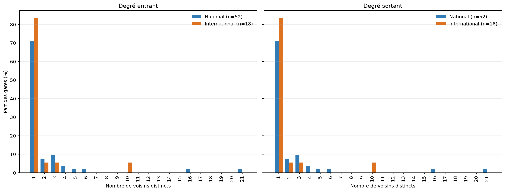
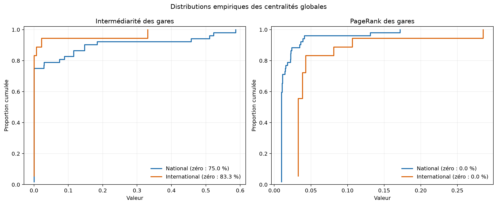
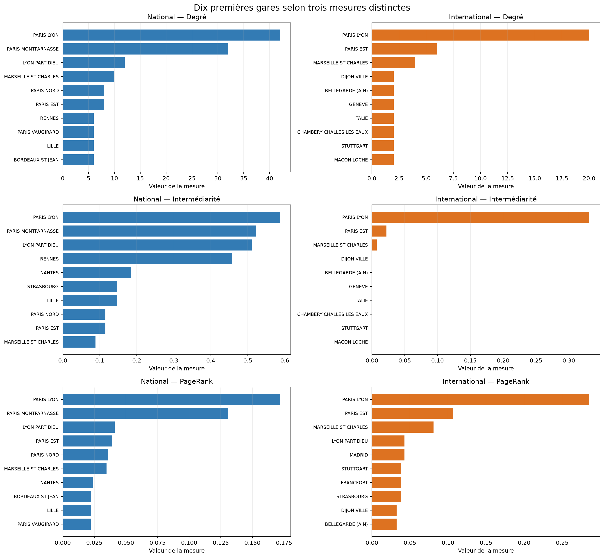
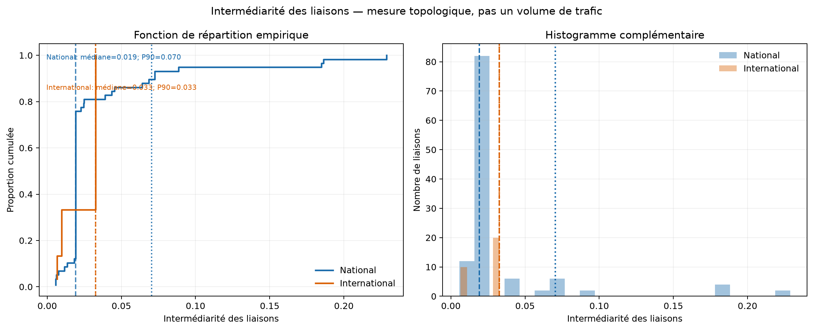
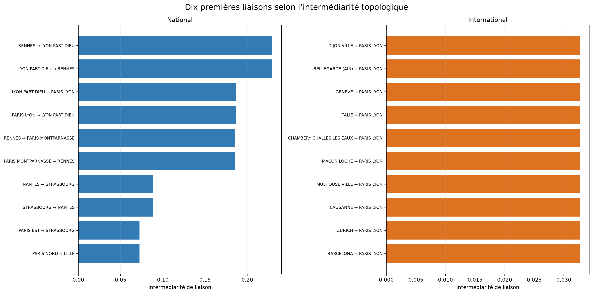
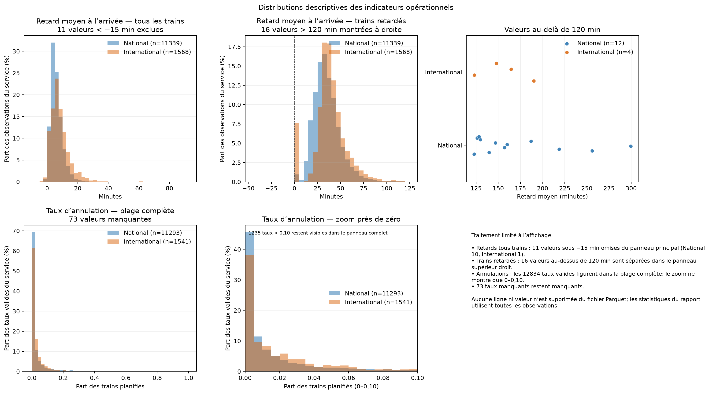

# Rapport de recherche — Réseau TGV et régularité

Ce rapport rassemble les résultats de recherche et sera enrichi au fil du projet. Le contenu ajouté hors de la section générée est conservé lors des mises à jour.

<!-- BEGIN GENERATED DESCRIPTIVE CONTENT -->
## Données et périmètre

L’analyse porte sur 12 907 observations mensuelles, du 2018-01 au 2026-09, pour les services International, National. Les métriques de graphe préexistantes sont résumées sans être recalculées.

## Structure des réseaux

**Question.** Les réseaux observés présentent-ils la même couverture et la même cohésion selon le service?

| Service | Gares | Liaisons dirigées | Composantes faiblement connexes | Composantes fortement connexes |
| --- | --- | --- | --- | --- |
| International | 18 | 30 | 3 | 3 |
| National | 52 | 116 | 1 | 1 |

**Observation.** National : 52 gares, 116 liaisons et 1 composante(s) faiblement connexe(s). International : 18 gares, 30 liaisons et 3 composante(s) faiblement connexe(s). 

**Interprétation.** Les composantes décrivent la connectivité des liaisons origine-destination observées. Elles ne signifient pas que les chemins du graphe sont des itinéraires réellement empruntés.

**Limite.** Le graphe ne décrit ni l’infrastructure physique ni le volume de trains ou de voyageurs.

## Degrés et centralité des gares

**Question.** Comment se répartissent les degrés et les centralités, et quelles gares occupent les premiers rangs?

| Service | Mesure | Rang | Gare | Valeur |
| --- | --- | --- | --- | --- |
| International | Degré total | 1 | PARIS LYON | 20.0 |
| International | Degré total | 2 | PARIS EST | 6.0 |
| International | Degré total | 3 | MARSEILLE ST CHARLES | 4.0 |
| International | Degré total | 4 | DIJON VILLE | 2.0 |
| International | Degré total | 5 | BELLEGARDE (AIN) | 2.0 |
| International | Degré total | 6 | GENEVE | 2.0 |
| International | Degré total | 7 | ITALIE | 2.0 |
| International | Degré total | 8 | CHAMBERY CHALLES LES EAUX | 2.0 |
| International | Degré total | 9 | STUTTGART | 2.0 |
| International | Degré total | 10 | MACON LOCHE | 2.0 |
| International | Intermédiarité | 1 | PARIS LYON | 0.33088235294117646 |
| International | Intermédiarité | 2 | PARIS EST | 0.022058823529411763 |
| International | Intermédiarité | 3 | MARSEILLE ST CHARLES | 0.007352941176470588 |
| International | Intermédiarité | 4 | DIJON VILLE | 0.0 |
| International | Intermédiarité | 5 | BELLEGARDE (AIN) | 0.0 |
| International | Intermédiarité | 6 | GENEVE | 0.0 |
| International | Intermédiarité | 7 | ITALIE | 0.0 |
| International | Intermédiarité | 8 | CHAMBERY CHALLES LES EAUX | 0.0 |
| International | Intermédiarité | 9 | STUTTGART | 0.0 |
| International | Intermédiarité | 10 | MACON LOCHE | 0.0 |
| International | PageRank | 1 | PARIS LYON | 0.2852883835824953 |
| International | PageRank | 2 | PARIS EST | 0.10660729511709768 |
| International | PageRank | 3 | MARSEILLE ST CHARLES | 0.08108142533632662 |
| International | PageRank | 4 | LYON PART DIEU | 0.04279262066517002 |
| International | PageRank | 5 | MADRID | 0.04279262066517002 |
| International | PageRank | 6 | STUTTGART | 0.0385383090350415 |
| International | PageRank | 7 | FRANCFORT | 0.0385383090350415 |
| International | PageRank | 8 | STRASBOURG | 0.0385383090350415 |
| International | PageRank | 9 | DIJON VILLE | 0.03258227275286161 |
| International | PageRank | 10 | BELLEGARDE (AIN) | 0.03258227275286161 |
| National | Degré total | 1 | PARIS LYON | 42.0 |
| National | Degré total | 2 | PARIS MONTPARNASSE | 32.0 |
| National | Degré total | 3 | LYON PART DIEU | 12.0 |
| National | Degré total | 4 | MARSEILLE ST CHARLES | 10.0 |
| National | Degré total | 5 | PARIS NORD | 8.0 |
| National | Degré total | 6 | PARIS EST | 8.0 |
| National | Degré total | 7 | RENNES | 6.0 |
| National | Degré total | 8 | PARIS VAUGIRARD | 6.0 |
| National | Degré total | 9 | LILLE | 6.0 |
| National | Degré total | 10 | BORDEAUX ST JEAN | 6.0 |
| National | Intermédiarité | 1 | PARIS LYON | 0.5868627450980392 |
| National | Intermédiarité | 2 | PARIS MONTPARNASSE | 0.5226797385620915 |
| National | Intermédiarité | 3 | LYON PART DIEU | 0.5106535947712418 |
| National | Intermédiarité | 4 | RENNES | 0.45751633986928103 |
| National | Intermédiarité | 5 | NANTES | 0.18405228758169928 |
| National | Intermédiarité | 6 | STRASBOURG | 0.14745098039215684 |
| National | Intermédiarité | 7 | LILLE | 0.14745098039215684 |
| National | Intermédiarité | 8 | PARIS NORD | 0.11529411764705882 |
| National | Intermédiarité | 9 | PARIS EST | 0.11529411764705882 |
| National | Intermédiarité | 10 | MARSEILLE ST CHARLES | 0.08836601307189543 |
| National | PageRank | 1 | PARIS LYON | 0.17174441902507526 |
| National | PageRank | 2 | PARIS MONTPARNASSE | 0.1310411009548053 |
| National | PageRank | 3 | LYON PART DIEU | 0.04111784045807942 |
| National | PageRank | 4 | PARIS EST | 0.03895192407431334 |
| National | PageRank | 5 | PARIS NORD | 0.03612785210989812 |
| National | PageRank | 6 | MARSEILLE ST CHARLES | 0.03462408480463789 |
| National | PageRank | 7 | NANTES | 0.023753339144473685 |
| National | PageRank | 8 | BORDEAUX ST JEAN | 0.022597911395462973 |
| National | PageRank | 9 | LILLE | 0.02227278734688863 |
| National | PageRank | 10 | PARIS VAUGIRARD | 0.02224213985496885 |

**Observation.** Les degrés comptent des voisins distincts et les graphiques de degrés comparent des proportions. Les distributions de centralité distinguent l’intermédiarité du PageRank et indiquent la proportion de valeurs nulles.

**Interprétation.** Un rang élevé correspond à une position topologique selon la mesure considérée; les mesures ne sont pas équivalentes.

**Limite.** Ces indicateurs ne mesurent ni la fréquentation voyageurs ni l’importance commerciale d’une gare.

## Intermédiarité des liaisons

**Question.** Quelle est la distribution de la position des liaisons dans les plus courts chemins topologiques?

| Service | Gare d’origine | Gare de destination | Intermédiarité de la liaison |
| --- | --- | --- | --- |
| National | RENNES | LYON PART DIEU | 0.22888386123680243 |
| National | LYON PART DIEU | RENNES | 0.22888386123680243 |
| National | LYON PART DIEU | PARIS LYON | 0.18627450980392157 |
| National | PARIS LYON | LYON PART DIEU | 0.18627450980392157 |
| National | RENNES | PARIS MONTPARNASSE | 0.1849861739567622 |
| National | PARIS MONTPARNASSE | RENNES | 0.18498617395676215 |
| National | NANTES | STRASBOURG | 0.08861236802413273 |
| National | STRASBOURG | NANTES | 0.08861236802413273 |
| National | PARIS EST | STRASBOURG | 0.07239819004524888 |
| National | PARIS NORD | LILLE | 0.07239819004524888 |
| International | DIJON VILLE | PARIS LYON | 0.032679738562091505 |
| International | BELLEGARDE (AIN) | PARIS LYON | 0.032679738562091505 |
| International | GENEVE | PARIS LYON | 0.032679738562091505 |
| International | ITALIE | PARIS LYON | 0.032679738562091505 |
| International | CHAMBERY CHALLES LES EAUX | PARIS LYON | 0.032679738562091505 |
| International | MACON LOCHE | PARIS LYON | 0.032679738562091505 |
| International | MULHOUSE VILLE | PARIS LYON | 0.032679738562091505 |
| International | LAUSANNE | PARIS LYON | 0.032679738562091505 |
| International | ZURICH | PARIS LYON | 0.032679738562091505 |
| International | BARCELONA | PARIS LYON | 0.032679738562091505 |

**Observation.** La fonction de répartition empirique est accompagnée d’un histogramme; médiane et 90e percentile sont indiqués par service. Le tableau emploie les noms de gare plutôt que les identifiants machine.

**Interprétation.** Une valeur élevée signale une position dans les plus courts chemins du graphe construit.

**Limite.** L’intermédiarité ne représente ni le volume de trains, ni le nombre de passagers, ni l’utilisation physique de la liaison.

## Évolution mensuelle

**Question.** Comment évoluent la couverture du réseau et les maxima mensuels de centralité?

Étendues de la couverture mensuelle observée :

- International : 8–17 gares et 12–28 liaisons dirigées observées par mois.
- National : 49–51 gares et 104–114 liaisons dirigées observées par mois.

Changements de la topologie Internationale observés en 2025 par rapport au mois précédent :

| Mois | Gares | Liaisons dirigées | Écart de gares | Écart de liaisons |
| --- | --- | --- | --- | --- |
| 2025-07 | 17 | 28 | 8 | 14 |
| 2025-10 | 8 | 12 | -9 | -16 |

**Observation.** Le PageRank maximal et l’intermédiarité maximale sont des maxima mensuels, pas des moyennes. Les annotations 2025 donnent les comptages réellement observés aux mois où ils changent.

**Interprétation.** Ces évolutions décrivent la couverture topologique des données mensuelles; elles ne démontrent pas une évolution opérationnelle.

**Limite.** Un maximum peut dépendre d’une seule gare. Les axes ne sont pas resserrés manuellement pour amplifier les variations.

## Indicateurs opérationnels : description

**Question.** Quelles distributions présentent les retards moyens et le taux d’annulation observés?

**Note de visualisation.** L’histogramme central du retard de tous les trains omet les observations signalées sous −15 min; celui des trains retardés sépare les valeurs supérieures à 120 min dans un panneau de queue. Le zoom des taux d’annulation est limité à 0–0,10, tandis que le panneau complet conserve toute la plage valide. Ces choix ne modifient que l’affichage; les valeurs restent dans le jeu de données.
Les annotations indiquent les effectifs omis des vues centrales (tous trains : 11; trains retardés : 16) et les taux au-dessus de 0,10 hors du zoom (1235). Les 73 taux manquants restent manquants.

Le tableau présente des statistiques calculées sur toutes les observations valides, y compris les valeurs absentes des histogrammes centraux.

| Service | Indicateur | N valide | N manquant | Moyenne (données complètes) | Médiane | Minimum | Maximum |
| --- | --- | --- | --- | --- | --- | --- | --- |
| International | Retard moyen, tous les trains (min) | 1568 | 0 | 8.13464130597585 | 7.152637588499999 | -163.0419831 | 61.81666667 |
| International | Retard moyen des trains retardés (min) | 1568 | 0 | 38.82986116744945 | 37.707142855 | 0.0 | 190.0 |
| International | Taux d’annulation (part) | 1541 | 27 | 0.03839872647652594 | 0.010752688172043012 | 0.0 | 0.875 |
| National | Retard moyen, tous les trains (min) | 11339 | 0 | 6.049146597231881 | 5.346153846 | -472.6388889 | 92.0 |
| National | Retard moyen des trains retardés (min) | 11339 | 0 | 35.174415951401265 | 33.19561404 | -40.10925926 | 299.6 |
| National | Taux d’annulation (part) | 11293 | 46 | 0.03671460793704895 | 0.006622516556291391 | 0.0 | 0.926829268292683 |

**Observation.** Les retards négatifs sont conservés. Les taux d’annulation manquants demeurent manquants et ne sont pas convertis en zéro.

**Interprétation.** Ces statistiques décrivent les résultats opérationnels par service sans évaluer leur relation aux métriques de graphe.

**Limite.** Les agrégats liaison-mois ne suffisent pas à attribuer une cause aux retards ou aux annulations.

## Portée et limites générales

Aucun test d’association ou modèle explicatif n’est présenté ici. Les constats descriptifs n’établissent ni association ni causalité. Les chemins calculés sur les liaisons OD observées ne représentent pas nécessairement des itinéraires de trains; les centralités ne mesurent ni les flux de voyageurs ni la propagation des retards.

<!-- END GENERATED DESCRIPTIVE CONTENT -->

<!-- Ajouter ici les analyses complémentaires, vérifications de robustesse et la discussion. -->
